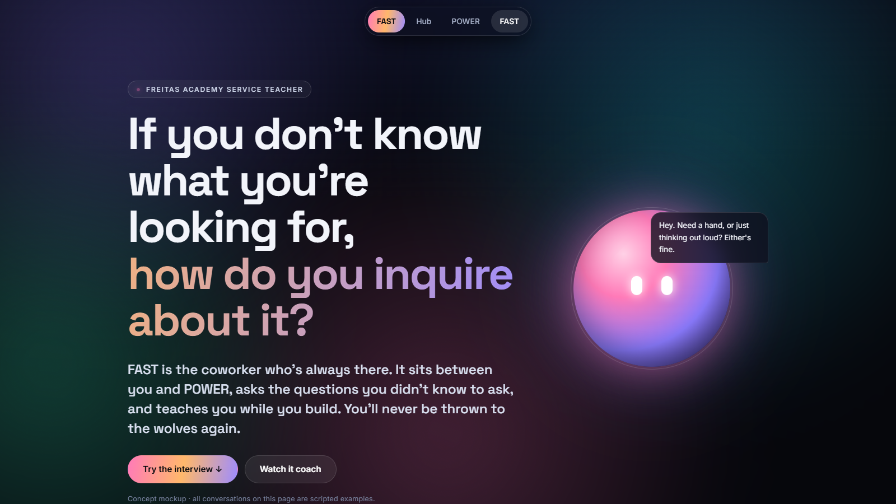
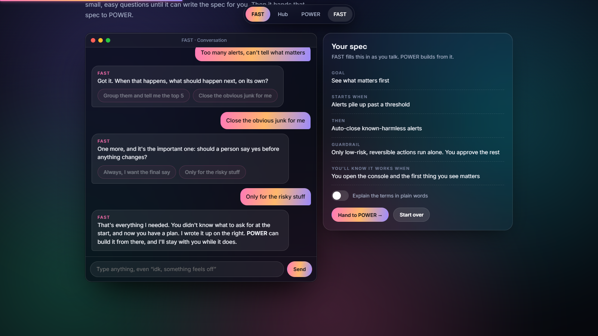

# FAST - Freitas Academy Service Teacher

**FAST - Never figure it out alone.**

Most people can feel a problem long before they can name it. FAST asks small, easy questions until it can write the spec
for you, and fills it in on the right as you talk. Then it hands that spec to POWER. You do not need to know what to
ask for; you just need to be willing to say "something feels off".
Everything on the page is simulated: no real data, no network calls, no install, no build step.

**Live demo:** https://tootenramen.github.io/FAST/

## The family

| Project | What it is |
|---|---|
| [FR33](https://github.com/Tootenramen/FR33) | the hub: alerts, cases, agents, audit |
| [POWER](https://github.com/Tootenramen/POWER) | describe an automation in plain words; it builds, tests and shows you the diff |
| [FAST](https://github.com/Tootenramen/FAST) | the always-there mentor: it asks small questions until it can write the spec for you |

## What's inside

| Path | What it is |
|---|---|
| `index.html` | the walkthrough page |
| `shared.css`, `shared.js` | the look (aurora glass) and the small dependency-free script behind it |
| `docs/` | screenshots used in this README |

## Use it

1. Visit the live demo, or open `index.html` in any browser.
2. Start with "idk, something feels off", answer a few taps, and watch the spec fill in. Press **Hand to POWER** to carry it over.

A concept page with a scripted conversation. The checklist of what is real yet lives in the
[FR33 repo](https://github.com/Tootenramen/FR33/blob/main/docs/BIBLE.md).

---
Built by [Gustavo Freitas](https://github.com/Tootenramen) - [LinkedIn](https://www.linkedin.com/in/gustavo-freitas-69b93910b/) - [more projects](https://github.com/Tootenramen)
